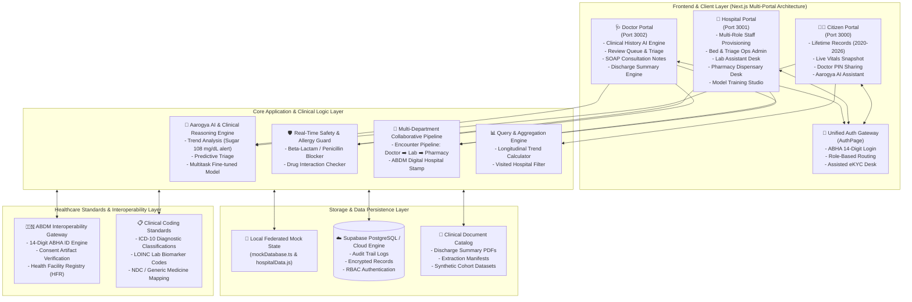
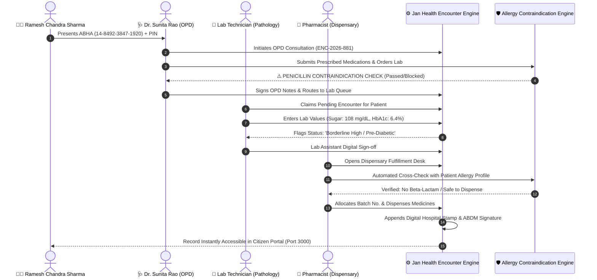

# Jan Health — System Architecture & Technical Blueprint

> **Ayushman Bharat Digital Mission (ABDM) Compliant Healthcare Ecosystem**  
> *Collaborative Multi-Portal Architecture connecting Citizens, Healthcare Providers, and Hospitals.*

---

## 1. Executive Summary

**Jan Health** is a federated, multi-role digital healthcare platform engineered to bridge the fragmentation across patient personal health records, doctor clinical workflows, and hospital operations. Built in compliance with India's **Ayushman Bharat Digital Mission (ABDM)**, the system enables:

1. **Citizens/Patients**: Unified lifetime health record tracking (2020–2026), dynamic biometric trends, secure doctor PIN sharing, and AI proactive health triaging.
2. **Doctors/Clinicians**: Longitudinal clinical history reviews, SOAP consultation notes, ICD-10 diagnostic coding, and AI clinical decision support.
3. **Hospitals & Clinical Staff**: Multi-role staff provisioning (Doctors, Lab Technicians, Pharmacists), live hospital bed and emergency triage management, and collaborative patient encounter execution.
4. **Safety & Guardrails**: Real-time cross-departmental allergy blockers (e.g., penicillin contraindication blocking) and biometric verification.

---

## 2. High-Level System Topology



---

## 3. Subsystem Breakdown

### 3.1 Citizen Portal (`Port 3000`)
* **Framework**: Next.js 14, React 18, Tailwind CSS, Lucide React.
* **Core Capabilities**:
  * **Unified Lifetime Records**: Chronological health history spanning 2020 to 2026 across multiple visited health networks (AIIMS, Fortis Escorts, Max Healthcare, Jan Seva Kendra).
  * **Dynamic Filtering**: Displays **only the hospitals actually visited** by the citizen for any selected timeframe.
  * **Doctor PIN Sharing**: Generates a temporary 4-digit access PIN (`8492`) & QR Code allowing external doctors to access past records with explicit citizen consent.
  * **Aarogya AI Assistant**: Proactive floating intelligence engine analyzing biometric trends (fasting blood sugar 108 mg/dL pre-diabetic alert, blood pressure 128/82, allergy warnings) without clinical jargon.

### 3.2 Hospital Clinical & Operations Portal (`Port 3001`)
* **Framework**: Next.js 14, React 18, Vanilla & Tailwind CSS tokens.
* **Core Capabilities**:
  * **Staff Directory & Provisioning**: Administrative module to create and verify roles for **Doctors**, **Diagnostic Lab Assistants**, and **Pharmacists**.
  * **Collaborative Patient Pipeline**: Collective single-patient data entry interface where all departments verify and append to the same encounter record (`ENC-2026-881` for *Ramesh Chandra Sharma*):
    * **OPD Doctor Desk**: Diagnosis, vitals, lab orders, and e-prescription.
    * **Diagnostic Lab Desk**: Input numerical test values (Fasting Sugar 108 mg/dL, HbA1c 6.4%, CBC) with auto-status thresholding.
    * **Pharmacy Dispensary Desk**: Drug batch verification, automated allergy safety cross-check, dispensing notes.
  * **Bed & Triage Operations**: Real-time ICU, Oxygen, and General ward occupancy telemetry with emergency hotline routing.
  * **Platform Operations & AI Governance**: Audit logs, ABDM consent tracking, and Model Training Studio for multi-task clinical AI fine-tuning.

### 3.3 Doctor Clinical Workspace (`Port 3002`)
* **Framework**: Next.js 14, TypeScript, Tailwind CSS, Lucide React.
* **Core Capabilities**:
  * **Intake & Provenance Review**: Full chronological audit trail of verified lab reports and discharge summaries.
  * **SOAP Consultation Notes**: Structured clinical documentation (Subjective, Objective, Assessment, Plan).
  * **Clinical Reasoning Engine**: Differential diagnosis support, LOINC biomarker tracking, and follow-up review triage.

---

## 4. Collaborative Encounter Data Flow

The platform's standout capability is the **Unified Multi-Department Encounter**, ensuring all hospital staff members collectively upload and sign off on a single patient's health event:



---

## 5. Security, ABDM Compliance & Clinical Safety

| Area | Implementation Details |
| :--- | :--- |
| **ABDM Identity** | 14-digit standardized ABHA ID (`XX-XXXX-XXXX-XXXX`) and compliant ABHA address format (`name@abdm`). |
| **Consent Model** | Time-bound, PIN-gated external doctor access (`doctorPin: 8492`) simulating ABDM Consent Artifacts. |
| **Drug Safety Engine** | Hard contraindication blocker: Active patient allergy to *Penicillin / Amoxicillin* prevents doctors and pharmacists from issuing or dispensing beta-lactam antibiotics. |
| **Coding Standards** | International Classification of Diseases (ICD-10) for diagnoses and LOINC standards for diagnostic lab biomarkers. |
| **Role-Based Access** | Segregated workspaces for Citizens, Clinicians, Lab Assistants, Pharmacists, and Hospital Admins. |

---

## 6. Directory Architecture

```text
ApnaHealth/
├── Citizen/                      # 🧑‍💼 Citizen Health Portal (Port 3000)
│   ├── src/
│   │   ├── app/                  # Main Citizen Dashboard & Header
│   │   ├── components/           # Aarogya AI Chatbot, Doctor PIN Modal, Detail Modals
│   │   ├── data/                 # Lifetime Medical Records (2020-2026) & Biometric Metrics
│   │   └── styles/               # Responsive Desktop & Mobile Styling
│   └── package.json
│
├── Hospital/                     # 🏥 Hospital & Clinical Operations (Port 3001)
│   ├── src/
│   │   ├── app/                  # Hospital Operations Dashboard & Desks
│   │   ├── components/           # Operations Admin, Model Training, Auth Gateway
│   │   ├── data/                 # ABDM Hospital Network, Staff Directory, Encounter Engine
│   │   └── styles/               # Role-accented Medical CSS
│   ├── documents/                # Hospital Discharge Summaries & Guidelines PDFs
│   ├── training/                 # Clinical AI Multi-Task Training Datasets
│   └── package.json
│
├── Doctor/                       # 🩺 Doctor Clinical Review Workspace (Port 3002)
│   ├── components/               # Doctor Dashboard, Review Queue, SOAP Notes, Reasoning
│   ├── documents/                # Clinical Discharge Summaries & Evaluation Guidelines
│   ├── lib/                      # Query Engines & Clinical Report Catalogs
│   ├── doctorMockData.ts         # Authorized Patients & Clinical Cohorts
│   └── package.json
│
├── system_architecture/          # 📐 System Blueprint & Documentation
│   ├── README.md                 # System Architecture Blueprint
│   ├── data_flow.md              # Detailed Data Flow & State Machine
│   └── api_schemas.md            # Data Schemas & ABDM Entity Models
│
└── package.json                  # Root Monorepo orchestrator (dev:citizen, dev:hospital, dev:doctor)
```
