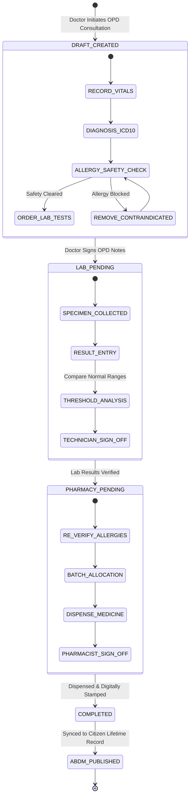
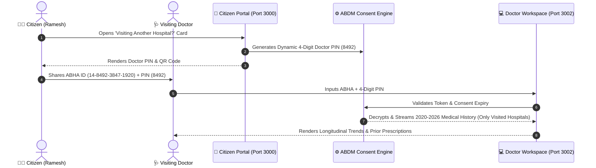
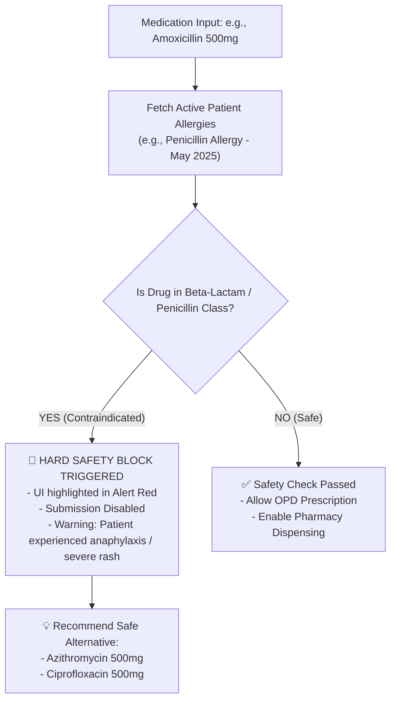

# Data Flow & Clinical State Machine

## 1. Collaborative Clinical Encounter State Machine

The multi-role clinical encounter (`ENC-XXXX`) follows a strict sequential state progression:

---

## 2. Citizen Doctor PIN Access Workflow

To ensure citizen data sovereignty and prevent unauthorized viewing, past medical history access follows an ABDM-inspired time-gated consent workflow:

---

## 3. Real-Time Allergy Safety & Contraindication Engine

The safety filter operates across both the **Physician Desk** and the **Pharmacy Dispensary Desk**:

